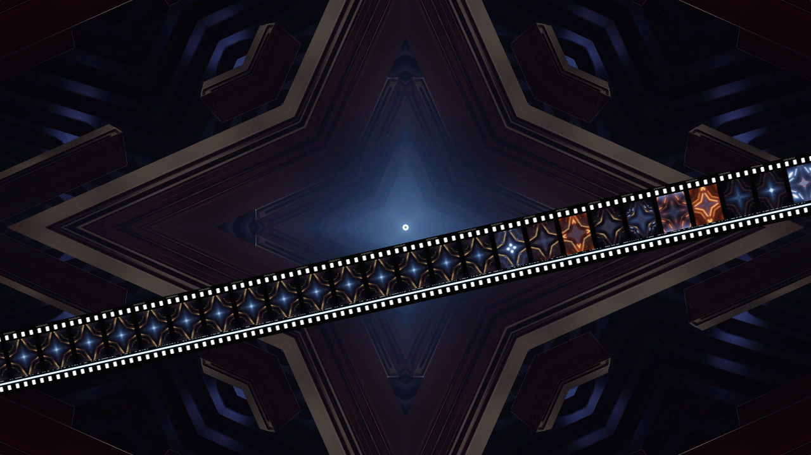
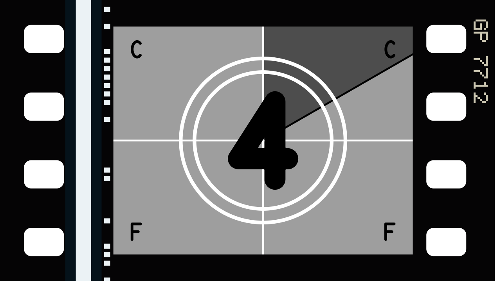
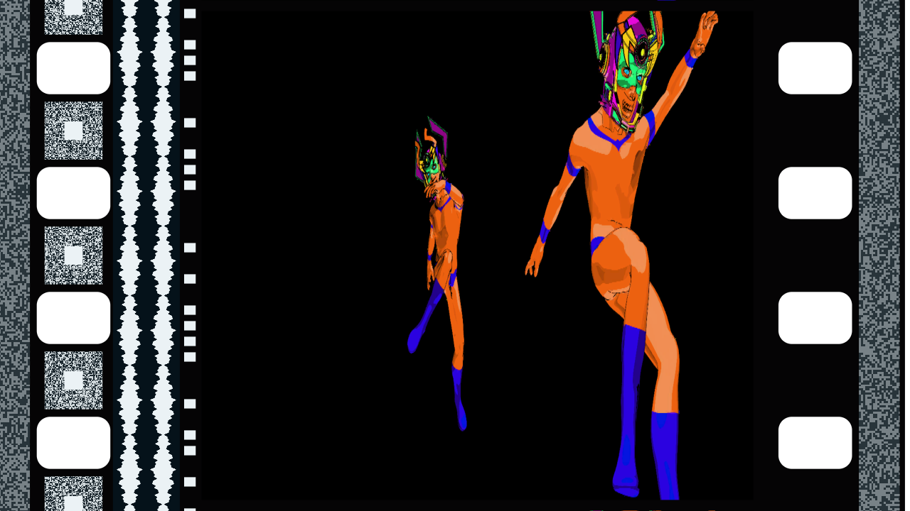

# gauge

> **AI-assisted project.** This codebase was created with [Claude](https://claude.com/claude-code)
> (Anthropic), directed and reviewed by a human author. Every claim below is measured:
> an offline harness drives the real plugin classes in a headless GL context and reads
> each one back out of the picture. Every format's holes, pictures and frame
> lines come back at the published dimensions to within float, a round disc through a 2×
> squeeze comes back half as wide as it is tall, every frame of a moving strip keeps the
> picture it was exposed with, the countdown runs frame for frame to the picture at
> exactly eight seconds (or eight beats, on the bar), and the optical track is the sound at
> the film's speed. Ten negative controls prove the checks can fail. It's **never been
> loaded into Resolume on macOS**; [oxbow](https://github.com/stoatworks-labs/oxbow), a real
> FFGL host that isn't Resolume, loads both bundles there.
> On Windows, both load, register and render in Resolume Arena 7.27.1 on a machine with
> software rendering and no GPU or sound device, every control is as declared, and every
> control that can act without sound changed the picture there but two of the leader's, which
> were too close to call.
> The full rundown is under [Status](#status), and every control is in the
> [user guide](docs/USER-GUIDE.md).

The film strip itself, as two FFGL plugins for [Resolume](https://resolume.com) Arena and
Avenue: **SW Gauge**, an effect that prints your clip onto 35 mm, 16 mm or Super 8, and
**SW Gauge Leader**, a source that runs the countdown.



<sub>Strip mode over Resolume's bundled `IntoTheGlow_02`, Surround set to Clip: the clip
full screen, and a strip of its own recent past running across it. Rendered by `gutest
--pipe`, the offline harness, not captured from Resolume.</sub>

## The one idea

A film strip is a standard.

Every gauge's perforations, pitch, apertures and soundtrack areas are published, in
inches mostly, by people who cared a great deal about thousandths of them. So the strip
here is built in film millimetres from those numbers, a camera looks at it, and each frame
on it is exposed once and keeps that picture as it travels. There's no grain, no gate
weave and no faded dye; [rebate](https://github.com/stoatworks-labs/rebate) does the
emulsion and [gate](https://github.com/stoatworks-labs/gate) does the projector, and gauge
sits happily in front of either.

## What falls out

None of these is drawn at a place on the screen. Each is the strip doing what it does:

- **Perforations, frame lines and borders where the standards put them.** 35 mm's KS holes
  are 2.794 mm across and 1.981 along, four to a frame on a 4.75 mm pitch, with the frame
  line midway between two of them. 16 mm's frame line runs through its hole. Super 8's
  one small hole, 0.914 mm across and 1.143 along, sits beside the middle of its frame.
- **The frame line is what the aperture leaves.** Academy's thick black bar (3 mm) and
  Scope's hairline (0.4 mm) are the same subtraction, the camera aperture's height from the
  frame pitch. Super 8's comes to 0.014 mm, which is to say the frames very nearly touch.
- **The anamorphic squeeze.** The picture is exposed through a 2× lens on Scope (or 1.33×,
  1.5× or 2× on anything else), so a round face is a tall thin one on the print. The
  leader on a Scope print is squeezed too.
- **A moving strip is a contact strip of the clip's past.** A frame is exposed when it
  comes into view and keeps that picture all the way across, so whatever the clip did half
  a second ago is still going past.
- **The frame above the gate is the one before.** In Cell mode the gate's frame shows the
  clip as it is now; the sliver of the frame above it is the last picture before the
  pull-down.
- **The optical track is the sound.** The variable-area track wiggles with the music
  coming in on the Audio input, drawn at the film's speed, so a high note is a finer
  ripple than a low one. Scope prints carry the lot: the stereo analogue track, DTS time
  code beside it, Dolby Digital blocks between the holes and SDDS down both edges, all as
  data without a logo in sight.
- **The countdown is film too.** PICTURE START, then 8 to 3 a second apart with the sweep
  going round, the C C F F control frames on the four, the 2 for a single frame with its
  pop on the soundtrack, black, and the picture at exactly eight seconds. At Rate Beat a
  count is a beat, and Start On Bar puts the picture on a downbeat two bars later. On a
  moving strip the leader goes past as a row of numbered frames.
- **A sync flash is one fully exposed frame.** One film frame long, wherever it lands, on a
  press, a beat or a bar.



<sub>`SW Gauge Leader` on the 4, the control frames' C C F F in the corners.</sub>



<sub>35 mm Scope over Resolume's `Galactucity_21`, a few tones on the Audio input: the
squeeze, and all four soundtracks.</sub>

### The honest limit

The geometry is published (I've checked it against a second table of the standards'
own figures, see Status) except where I couldn't find a drawing: the DTS, Dolby Digital
and SDDS placements and the 16 mm optical track are put by eye in the space the standards
leave for them. The countdown is after the SMPTE Universal Leader, but the greys, the line
weights and the typeface are mine, and the numerals are a stroked face rather than the
original's Futura. A real 35 mm print carries its sound about 21 frames ahead of the
picture; this one prints it level, because the clip's next second hasn't happened yet.
And the FFT input's 64 bins are assumed to run evenly from 0 to 22 kHz, which nobody has
measured; it only sets how finely the track wiggles.

## Controls

**SW Gauge** (effect)

| Group | |
| --- | --- |
| **Film** | Format (35 mm Academy, 35 mm Scope, 35 mm Full, 35 mm Still, 16 mm, 16 mm Sound, Super 16, Super 8), Stock (Colour Print, B&W Print, Clear Base), Squeeze (Format, None, 1.33x, 1.5x, 2x), Fit (Crop, Letterbox, Stretch), Edge Print, Soundtracks, Track Level, Audio. |
| **View** | Mode (Cell, Strip). Cell: Framing, Rack, Drift. Strip: Size, Angle, Position, Travel. Shutter (motion blur). |
| **Frames** | Rate (24, 25, 18 or 16 fps, or Beat), Frames (Held, Live). |
| **Leader** | Roll Leader, Start On (Press, Beat, Bar), Pop Frame (Number, Flash), Flash, Auto Flash (Off, Beat, Bar). |
| **Surround** | Holes (Light, Clear, Black), Surround (Clear, Black, Light, Clip), Mix. |

**SW Gauge Leader** (source) has the same Film, View, Rate and Surround controls, less
Fit, Audio, Track Level, Frames, Mix and the Clip surround (a leader has no clip, and no
programme sound to put on the track, just its pop). Its Leader group adds **Loop**, on by
default, and **After** (Black or Clear) for what follows a leader that doesn't loop.

The defaults are a 35 mm Academy release print, one frame filling the output with its
holes and track either side, at 24 fps, the clip held frame by frame. Mode Strip gives a
strip 30% of the output high running at two frames a second. Clear holes and a Clear
surround let whatever's on the layers below show through the film. The
[user guide](docs/USER-GUIDE.md) has every control with its range and default.

> **Photosensitivity.** Auto Flash on Beat flashes a whole frame white once a beat:
> 2 Hz at 120 bpm, and 3 Hz from 180 bpm up, where it enters the 3–30 Hz band broadcast
> flash guidelines restrict. Use it with care.

## Status

**v0.1.0, 14 October 2026, and still early days.** User guide:
[stoatworks-labs.com/software/gauge/guide](https://stoatworks-labs.com/software/gauge/guide/).

### Measured offline, on macOS

`tools/verify.sh` passes on this machine (M4 Max, macOS 26.4.1) against a fresh universal
Release build, with every check run at 320×180 and 1280×720 (and the geometry at 640×480
and 333×187 by hand). What it establishes:

| check | result |
| --- | --- |
| `--perfs` | all eight formats: 35 mm holes 2.7940 × 1.9812 mm, 2.0100 from the edge, 4.7500 apart, four (eight on the still roll) to a 19.0000 (38.0000) mm frame; 16 mm 1.8290 × 1.2700, 0.9000, 7.6200, one to a frame; Super 8 0.9140 × 1.1430, 0.5100, 4.2340, one to a frame. Each against the model to a thousandth of a pixel, and against a separate table of the published figures to within 0.005 mm (the furthest is the edge distance, where the model rounds 0.079 in, 2.0066 mm, to 2.01). Every hole sits within 1.4e-7 of a pitch of where the frame line puts it |
| `--aperture` | every picture's width, height and centre exact to the same tolerance; frame lines 2.998 mm (Academy), 0.407 (Scope), 0.331 (Full), 2.000 (Still), 0.127 (16 mm), 0.210 (Super 16), 0.014 (Super 8) |
| `--squeeze` | a disc that's round as seen reads back on the film at 0.50002 wide against tall through Scope's 2×, and at 1/1.33, 1/1.5 and 1/2 on Academy, Super 16, Super 8 and the still roll, each inside a band derived from the blur |
| `--held` | every frame on a strip moving at 6 fps holds the input of the host frame on which it came into view; a picture moves 97.7842 px in a sixth of a second against 97.7841; in Cell the frame above the gate holds the last picture before its pull-down |
| `--leader` | 209 host frames at 24 Hz, none wrong: PICTURE START, each count's number read by template against the face's own digits, the sweep within 0.004 of k/24 of the circle, the 2 for one frame, black to frame 191, the clip at frame 192. At Rate Beat (125 bpm, Start On Bar) PICTURE START lands on the third bar and the clip on the fifth, to the frame |
| `--flash` | a press flashes exactly one film frame; at 60 Hz it is white on exactly the two host frames that film frame spans; Auto Flash Beat over four seconds whitens the same 21 host frames the beats predict |
| `--track` | one FFT bin at 0.25 is a sine of 0.25000 at 1.1333 cycles a millimetre (its frequency at 24 fps), residual 1.5e-6; silence is a band of constant width; the leader's 2 carries 1 kHz at 0.80001 and the frames either side are silent |
| `--alpha` | exactly 0 off the film and in a clear hole, exactly 1 on the rebate and in a picture of a half-transparent clip; the source's After Clear frames are cut out of the film |
| `--resize` | a moving strip's held frames survive the raster doubling (the ring reallocated from 112×96 to 224×176 cells) with every frame unchanged |
| `--negative` | ten broken models (a hole turned through 90°, the 35 mm frame line through a hole, the picture centred on a sound print, the squeeze ignored, held frames re-exposed every frame, 25 frames to a count, a two-frame flash, the track at the wrong speed, opaque clear holes, a resize that forgets) each **fail** their check |
| mutation | one character of the shipped GLSL (the holes' repeat, `+ jh` to `- jh`) caught by `--perfs`, `--aperture` and `--alpha`, then reverted |
| `tools/sweep.py` | every control of both plugins but the Audio input (the host's FFT, which Track Level sweeps) measurably changes the picture: **50** of the 51 declared |
| shaders | all four compile through `glslc` as the plugin assembles them |
| the bundles | both universal, export `plugMain` and ad-hoc sign; `oxbow` sees `SW Gauge` / `GU01` / effect and `SW Gauge Leader` / `GU02` / source, and renders 120 frames through each |

Render cost, `gutest --bench`, best of three runs of 60 frames, `glFinish` both sides, on
a GPU shared with other work:

| | defaults (Cell) | Strip at 24 fps, 360° shutter |
| --- | --- | --- |
| 1280×720 | 0.08 ms | 0.12 ms |
| 1920×1080 | 0.09 ms | 0.21 ms |
| 3840×2160 | 0.36 ms | 0.42 ms |

Under a fortieth of a 60 fps frame either way. The held frames cost memory instead: up to
40 megapixels of RGBA8 for a strip full of large frames.

### Not established

It's **never been loaded into Resolume on macOS**. There, how the effect's 27 controls and
the source's 24 present in Arena's inspector, whether Resolume feeds the Audio input the
way the harness does, and what the host's beat info really does to Start On are untested;
the one host it's run in on a Mac is `oxbow`, for 120 frames through each bundle.

On Windows, the x64 build loads, registers and renders in Resolume Arena 7.27.1 on the
fleet's Windows machine, which has software rendering (Mesa llvmpipe), no GPU and no sound
device. It passed all 15 of the fleet's Arena checks that can run there (the audio one
is skipped): every control as declared,
by name, order, type, range and default; all 24 of the effect's controls that can act
without sound changed the picture there (seven of them with another control set first),
and so did 20 of the leader's 22 in one run and 17 in a second, the rest
too close to call against a countdown that never sits still (Edge Print and Shutter in
both runs); and Arena's log had nothing to complain about. The Audio
input and Track Level couldn't be tried without a sound card, and nobody has looked at its
panel there.

The look has been seen on a test card and Resolume's bundled demo clips through `gutest
--pipe`, never on camera footage or a real film scan. There's a
[user guide](docs/USER-GUIDE.md), but no OpenFX port, no browser demo and no factory
presets; none is needed for 0.1.0.

## Build

Needs CMake 3.15+, a C++17 compiler and the FFGL SDK submodule.

```sh
git clone --recurse-submodules https://github.com/stoatworks-labs/gauge
cd gauge
cmake -B build -DCMAKE_BUILD_TYPE=Release
cmake --build build --parallel
```

The macOS bundles (`Gauge.bundle` and `Gauge Leader.bundle`) are universal. `cmake
--install build` copies both into `~/Documents/Resolume Arena/Extra Effects`; for
Avenue, pass `--prefix "$HOME/Documents/Resolume Avenue/Extra Effects"`. Windows needs
GLEW through vcpkg.

## Building and testing

```sh
tools/verify.sh                                   # everything, about 40 seconds
./build/gutest --list                             # the effect's parameters
./build/gutest --plugin source --list             # the source's
./build/gutest --perfs --size 320x180             # one check
./build/gutest --negative                         # every check can fail
python3 tools/sweep.py                            # no dead controls
./build/gutest --out frame.png --set "Format=35 mm Scope" --set "Mode=Strip"
ffmpeg -i clip.mov -vf fps=60 -f rawvideo -pix_fmt rgba - | ./build/gutest --pipe --size 1280x720 | ffplay -f rawvideo -pixel_format rgba -video_size 1280x720 -framerate 60 -
```

`CLAUDE.md` is the command reference and `AGENTS.md` the reasoning: the strip, the traps,
and where every tolerance comes from.

## Licence

MIT, see [LICENSE](LICENSE). What it builds on is in [ATTRIBUTIONS.md](ATTRIBUTIONS.md).

<!-- attributions:start -->
This project is built on other people's work — see [ATTRIBUTIONS.md](ATTRIBUTIONS.md).
<!-- attributions:end -->
